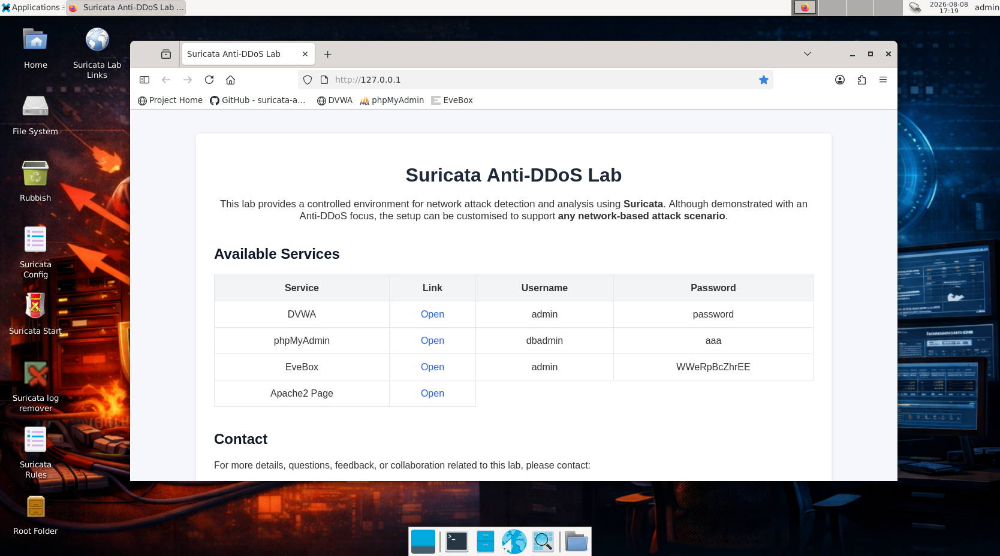

# Suricata Anti-DDoS Lab

This repository provides a **step-by-step basic guide** for using the **suricata-lab VMWare VM**,  
a lightweight Linux lab for experimenting with **Suricata IDS** and **EveBox**,
using **DVWA** as a traffic target.

---
## Scope and Customisation

Although this lab is presented with an Anti-DDoS focus, the setup is **fully customisable** and can be adapted to simulate and analyse **any network-based attack** supported by Suricata rules.

By modifying traffic generation, rule sets, and logging configurations, the same environment can be reused for intrusion detection, reconnaissance, brute-force attempts, scanning activity, and other security scenarios.  
This makes the lab suitable for broader **network security, blue-team, and SOC training** beyond DDoS use cases.

---
## Screenshot



---

## 📦 VM Download

- Download the VMware image [here](https://sourceforge.net/projects/suricata-anti-ddos/files/)

---

## 🧩 What’s Inside the VM

- Debian (XFCE)
- MySQL and phpMyAdmin
- Suricata (IDS mode)
- EveBox (SQLite backend)
- DVWA (Apache + MariaDB)
- SSH (Open SSH)

This VM is designed for **detection and alert analysis**, not prevention.

---

## 🚀 Getting Started
- Uncompress the `.7z` image file
- Open the VM folder from VMware

### VMware Compatibility Fix

If you encounter a hardware compatibility issue, update the VM's hardware compatibility in VMware:

1. Select the VM, then go to **VM > Manage > Change Hardware Compatibility**.
2. Click **Next** and select the latest version from the dropdown.
3. Click **Next**, then choose **Alter this virtual machine**.
4. Click **Next > Finish**.

## 🔗 Web Interfaces Available in the VM

The following web interfaces are pre-installed and accessible from within the VM
(or from another machine on the same network, depending on configuration):

### 🏠 Home Page
A simple landing page is provided to link to the available lab services.  
`http://<VM-IP>/`
### 🧪 DVWA (Damn Vulnerable Web Application)
Used as a deliberately vulnerable target to generate attack traffic.
`http://<VM-IP>/dvwa/`
### 🗄 phpMyAdmin
Web interface for managing the MariaDB database used by DVWA.
`http://<VM-IP>/phpmyadmin/`
### 📊 EveBox
Web-based alert viewer for Suricata, used to inspect and analyze detected events.
`https://<VM-IP>:5636`
> Note: EveBox uses a self-signed TLS certificate. Browsers will display a warning
on first access.

## 🖥 Desktop Launchers (Inside the VM)

The VM desktop includes several shortcuts to simplify common tasks:

### 📁 Root folder
Opens the filesystem root (`/`) with administrative privileges.  
Useful for inspecting system directories and logs.

### ▶ Suricata start
Starts **Suricata manually** in IDS mode on the primary network interface.  
Suricata is intentionally **not run as a service** in this lab.
```bash
sudo suricata -c /etc/suricata/suricata.yaml -i ens33
```
### ⚙ Suricata config
Opens the main Suricata configuration file (`suricata.yaml`) with admin rights.  
Used to enable/disable logging options and adjust detection behaviour.
```bash
sudo mousepad /etc/suricata/suricata.yaml
```
### 📜 Suricata Local Rules
Opens the local rules file (`local.rules`) where custom detection rules
(e.g. SYN flood detection) are defined and modified.
```bash
sudo mousepad /var/lib/suricata/rules/local.rules
```
### 📊 EveBox 
**EveBox** is the web-based alert viewer for Suricata the IDS.  
EveBox reads alerts from `eve.json` and provides a simple UI for analysis.
The luncher is removed as it will auto start as a service, but here are some useful commands:
```bash
# To check the status
systemctl status evebox
# To stop it as a service
sudo systemctl stop evebox
# To start it manually
sudo /evebox/evebox-0.23.0-linux-x64/evebox server --datastore sqlite --input /var/log/suricata/eve.json --host 0.0.0.0
```
### Suricata log remover Launcher

This launcher opens a terminal, deletes all existing Suricata log files, and provides immediate confirmation to the user.
Here is the used command:
```bash
sudo rm -f /var/log/suricata/* 
```

> **All launchers are provided for convenience; commands can also be run manually from a terminal.**

## 🚨 Included Detection Rule

The VM includes a **custom Suricata rule for detecting SYN-based DoS/DDoS attacks**.

- The rule detects **abnormally high rates of TCP SYN packets**
- Alerts are **rate-limited** to avoid log flooding
- Alerts are visible in **EveBox**

This rule is intended for **learning and experimentation** and can be modified
by students to observe how threshold values affect detection and false positives.

The rule can be found at:
```bash
/var/lib/suricata/rules/local.rules
```

## 📬 Contact, Support, and Suggestions

This lab VM is provided for **educational use**.

If you encounter issues, have questions, or would like to suggest improvements
(e.g. additional detection scenarios, rules, or lab tasks), please use one of the following:

- **GitHub Issues:**  
  Open an issue in this repository for bugs, errors, or suggestions.

- **Pull Requests:**  
  Improvements to documentation are welcome via pull requests.

This project is maintained on a **best-effort basis** and primarily intended for
teaching and learning purposes.


**Maintained by:**  
Kaled Aljebur
